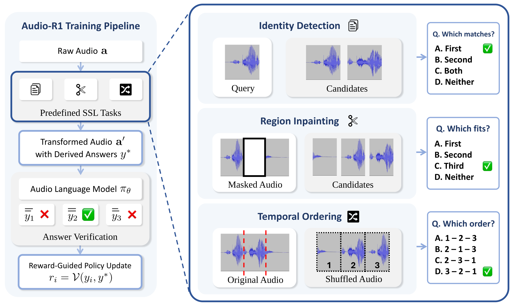

<div align="center">

<a href="https://ijihoon98.github.io/Audio-R1/"></a>

# Audio-R1

**Audio Reasoning through Reinforcement Learning on Self-Supervised Tasks**

[](https://arxiv.org/abs/2610.34609)
[](https://ijihoon98.github.io/Audio-R1/)
[](https://huggingface.co/collections/NearAndDear98/audio-r1-6ae0fa669ac2166beb0b5db6)
[](https://github.com/ijihoon98/Audio-R1)

[**Overview**](#overview) &nbsp;·&nbsp; [**Tasks**](#self-supervised-tasks) &nbsp;·&nbsp; [**Models**](#models) &nbsp;·&nbsp; [**Getting Started**](#getting-started) &nbsp;·&nbsp; [**Citation**](#citation)

Jihoon Jeong<sup>1,2</sup> · Mirco Ravanelli<sup>1,3</sup> · Zhepei Wang<sup>4</sup> · Cem Subakan<sup>1,2,3</sup>

<sup>1</sup>Mila-Québec AI Institute &nbsp; <sup>2</sup>Université Laval &nbsp; <sup>3</sup>Concordia University &nbsp; <sup>4</sup>Adobe Research

</div>

## Overview

**Audio-R1** is a reinforcement learning (RL) post-training framework that revisits audio self-supervised learning as a source of **verifiable rewards**. Each self-supervised task is built from raw audio, so its answer is known by construction: Audio-R1 uses that answer to verify model responses and compute GRPO rewards, with no human labels or reasoning demonstrations.

> [!NOTE]
> **Any audio collection can become training data.** The generators in [`data_gen/`](data_gen) turn unlabeled speech into multiple-choice questions with automatically determined answers.

<p align="center">
  <a href="assets/overview.png"></a>
  <br><sub>Audio-R1 overview. Click the figure to view it at full resolution.</sub>
</p>

## Self-Supervised Tasks

| Task | Input | Question | Generator |
| :--- | :--- | :--- | :--- |
| **Identity Detection** | an anchor clip and two candidates | Which candidates are the same recording as the anchor? | [`make_identity.py`](data_gen/make_identity.py) |
| **Region Inpainting** | a clip with a silenced region and candidate fills | Which candidate fills the gap? | [`make_inpainting.py`](data_gen/make_inpainting.py) |
| **Temporal Ordering** | three shuffled segments of one clip | What is the original order? | [`make_ordering.py`](data_gen/make_ordering.py) |

## Models

LoRA adapters on Hugging Face, grouped in the [Audio-R1 collection](https://huggingface.co/collections/NearAndDear98/audio-r1-6ae0fa669ac2166beb0b5db6); each card includes a loading example.

| Model | Base | Training tasks | License |
| :--- | :--- | :--- | :--- |
| [🤗 Audio-R1-Qwen2.5-Omni-7B](https://huggingface.co/NearAndDear98/Audio-R1-Qwen2.5-Omni-7B) | [Qwen2.5-Omni-7B](https://huggingface.co/Qwen/Qwen2.5-Omni-7B) | identity · inpainting · ordering | Apache 2.0 |
| [🤗 Audio-R1-Gemma-4-E4B-it](https://huggingface.co/NearAndDear98/Audio-R1-Gemma-4-E4B-it) | [Gemma 4 E4B-it](https://huggingface.co/google/gemma-4-E4B-it) | identity · inpainting · ordering | Apache 2.0 |
| [🤗 Audio-R1-AF-Next-Think](https://huggingface.co/NearAndDear98/Audio-R1-AF-Next-Think) | [AF-Next-Think](https://huggingface.co/nvidia/audio-flamingo-next-think-hf) | identity · inpainting | NVIDIA non-commercial |

## Getting Started

Point each generator at any directory of audio (searched recursively; wav / mp3 / flac, resampled to 16 kHz). It writes a JSONL of questions plus the derived clips; `--max-sources N` samples a random subset of a large corpus.
```bash
python data_gen/make_identity.py   --audio-dir <audio_dir> --out-dir <out>/identity
python data_gen/make_inpainting.py --audio-dir <audio_dir> --out-dir <out>/inpainting
python data_gen/make_ordering.py   --audio-dir <audio_dir> --out-dir <out>/ordering
```

## Citation

```bibtex
@article{jeong2026audior1,
  title   = {Audio-R1: Audio Reasoning through Reinforcement Learning on Self-Supervised Tasks},
  author  = {Jeong, Jihoon and Ravanelli, Mirco and Wang, Zhepei and Subakan, Cem},
  journal = {arXiv preprint arXiv:2610.34609},
  year    = {2026}
}
```
